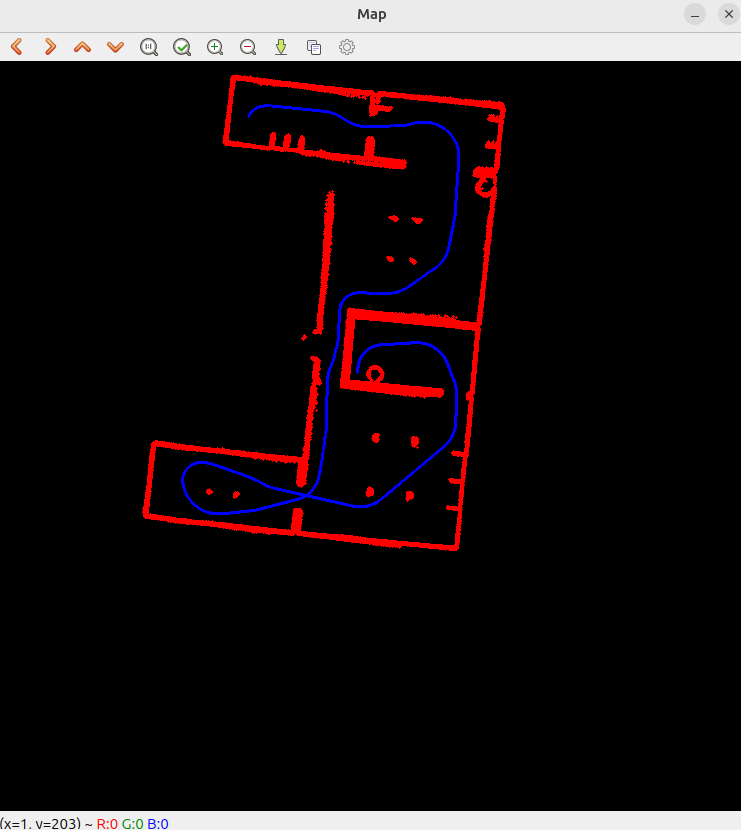
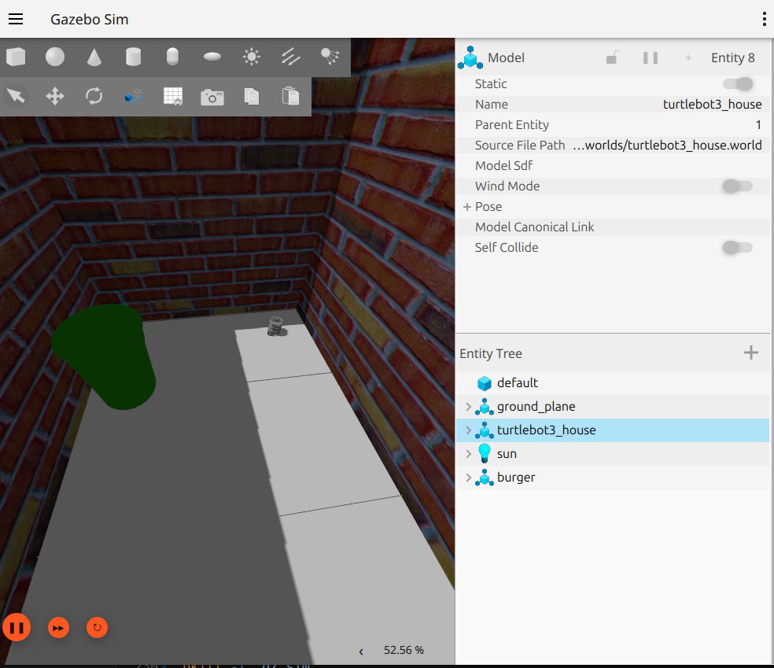

# low_level_autonomy

BLM6191 Robotlar — Ödev 1

Bu ROS 2 paketi TurtleBot3 için iki düşük seviyeli otonomi davranışı içerir:

| Düğüm | Soru | Ne yapar |
|---|---|---|
| `lidar_odom_map_node` | Soru 1 | `/scan` ve `/odom` mesajlarını kullanarak LiDAR ölçümlerini robotun başlangıç çerçevesine (`odom`) taşır ve OpenCV penceresinde birikimli bir harita çizer. |
| `bump_go_node` | Soru 2 | `/scan` mesajına göre önündeki kontrol alanını denetler, `/cmd_vel` üzerinden hareket komutu yayınlayarak engellere çarpmadan gezinir (çarp / dön / git). |
| `vis_lidar_node` | — | Ders tarafından hazır verilen LiDAR görselleştirme düğümü. |

Paket, `turtlebot3_house` dünyasında elle sürülen bir TurtleBot3'ten kaydedilmiş bir bag dosyası (`bag/hw1`) içerir.

---

## 1. Gereksinimler

- Ubuntu 24.04
- ROS 2 Jazzy
- OpenCV, colcon, git
- TurtleBot3 simülasyon paketleri (sadece `bump_go_node` için)

### 1.1 ROS 2 Jazzy kurulumu

ROS 2 Jazzy kurulu değilse [resmi kurulum adımlarını](https://docs.ros.org/en/jazzy/Installation/Ubuntu-Install-Debs.html) izleyin. Özetle:

```bash
sudo apt install software-properties-common curl -y
sudo add-apt-repository universe

export ROS_APT_SOURCE_VERSION=$(curl -s https://api.github.com/repos/ros-infrastructure/ros-apt-source/releases/latest | grep -F "tag_name" | awk -F\" '{print $4}')
curl -L -o /tmp/ros2-apt-source.deb "https://github.com/ros-infrastructure/ros-apt-source/releases/download/${ROS_APT_SOURCE_VERSION}/ros2-apt-source_${ROS_APT_SOURCE_VERSION}.$(. /etc/os-release && echo $VERSION_CODENAME)_all.deb"
sudo dpkg -i /tmp/ros2-apt-source.deb

sudo apt update
sudo apt install ros-jazzy-desktop -y
```

### 1.2 Derleme araçları ve bağımlılıklar

```bash
sudo apt install git python3-colcon-common-extensions libopencv-dev -y
```

### 1.3 TurtleBot3 simülasyon paketleri

```bash
sudo apt install ros-jazzy-turtlebot3* -y
```

### 1.4 Ortam değişkenleri

ROS ortamını ve TurtleBot3 modelini her terminalde otomatik yüklemek için `~/.bashrc` dosyasına ekleyin:

```bash
echo "source /opt/ros/jazzy/setup.bash" >> ~/.bashrc
echo "export TURTLEBOT3_MODEL=burger" >> ~/.bashrc
source ~/.bashrc
```

---

## 2. Kurulum

### 2.1 Workspace oluşturma ve repoyu klonlama

```bash
mkdir -p ~/ros2_ws/src
cd ~/ros2_ws/src
git clone https://gitlab.com/blm6191_2627g/members/<ogrenci_no>/low_level_autonomy.git
```

### 2.2 Derleme

```bash
cd ~/ros2_ws
colcon build --packages-select low_level_autonomy
```

### 2.3 Workspace'i ortama ekleme

```bash
echo "source ~/ros2_ws/install/setup.bash" >> ~/.bashrc
source ~/.bashrc
```

Kurulumun doğru olduğunu kontrol etmek için:

```bash
ros2 pkg executables low_level_autonomy
```

Çıktıda `lidar_odom_map_node`, `bump_go_node` ve `vis_lidar_node` görünmelidir.

---

## 3. Çalıştırma

### 3.1 Soru 1 — LiDAR Odom Haritalama (`lidar_odom_map_node`)

Terminal 1 — düğümü başlatın:

```bash
ros2 run low_level_autonomy lidar_odom_map_node
```

Terminal 2 (`CTRL+ALT+T`) — kayıtlı bag dosyasını oynatın:

```bash
ros2 bag play ~/ros2_ws/src/low_level_autonomy/bag/hw1
```

Bag oynadıkça `Map` isimli OpenCV penceresinde ev haritası birikimli olarak oluşur:
- **Kırmızı noktalar:** `odom` çerçevesine taşınmış LiDAR ölçümleri (duvarlar, engeller)
- **Mavi noktalar:** robotun `odom` çerçevesindeki izlediği yol

### 3.2 Soru 2 — Bump-Go Node (`bump_go_node`)

Terminal 1 — Gazebo'da `turtlebot3_house` dünyasını başlatın:

```bash
ros2 launch low_level_autonomy house.launch.py
```

Terminal 2 (`CTRL+ALT+T`) — düğümü başlatın:

```bash
ros2 run low_level_autonomy bump_go_node
```

Robot düz ilerler, önündeki kontrol alanına engel girince boş tarafa döner ve alan boşalınca tekrar düz devam eder. Terminalde her taramada sol/sağ yarıdaki nokta sayısı ve o anki durum (`GO_FORWARD`, `TURN`, `BREAK_LOOP`) yazdırılır.

### 3.3 LiDAR görselleştirme (`vis_lidar_node`)

```bash
rviz2 -d ~/ros2_ws/src/low_level_autonomy/rviz/vis_lidar.rviz
```
```bash
ros2 run low_level_autonomy vis_lidar_node
```
```bash
ros2 bag play ~/ros2_ws/src/low_level_autonomy/bag/hw1
```

---

## 4. Yöntem

### 4.1 LiDAR Odom Haritalama

Düğüm iki konuya abonedir:
- `/odom` (`nav_msgs/msg/Odometry`): Robotun (`base_footprint`) başlangıç çerçevesine (`odom`) göre son pozu saklanır.
- `/scan` (`sensor_msgs/msg/LaserScan`): Her tarama, saklanan son poz kullanılarak `odom` çerçevesine taşınıp haritaya çizilir.

**Yaw hesabı.** Robot düzlemde hareket ettiği için quaternion'ın `x`, `y` bileşenleri sıfırdır ve z ekseni etrafındaki dönüş:

```
yaw = atan2(2·w·z, 1 − 2·z²)
```

**Dönüşüm zinciri** (`base_scan → base_footprint → odom`). Her geçerli ölçüm (`r`, `θ`) için:

| Adım | Çerçeve | Hesap |
|---|---|---|
| 1 | `base_scan` | `xs = r·cos θ`, `ys = r·sin θ` |
| 2 | `base_footprint` | `xb = xs − 0.032`, `yb = ys` (LiDAR robota göre x'te −0.032 m kaydırılmış; z'deki 0.182 m 2B haritayı etkilemez) |
| 3 | yaw kadar döndürme | `xr = cos(yaw)·xb − sin(yaw)·yb`, `yr = sin(yaw)·xb + cos(yaw)·yb` |
| 4 | `odom` | `xo = x_robot + xr`, `yo = y_robot + yr` |
| 5 | piksel | `u = WINDOW/2 + xo·MT_TO_PIXEL`, `v = WINDOW/2 − yo·MT_TO_PIXEL` |

5. adımdaki eksi işareti, görüntüde satır numarasının aşağı doğru artmasından kaynaklanır (`odom`'da y yukarı doğrudur). Harita görüntüsü düğümün üye değişkenidir ve hiç sıfırlanmadığından ölçümler birikir.

| Parametre (`lidar_odom_map.h`) | Değer | Açıklama |
|---|---|---|
| `WINDOW` | 750 | Harita görüntüsünün kenar uzunluğu (piksel) |
| `MT_TO_PIXEL` | 30 | Ölçek (piksel / metre) |

### 4.2 ump-Go Node

Düğüm `/scan` mesajına abonedir ve `/cmd_vel` konusuna `geometry_msgs/msg/TwistStamped` yayınlar.

**Kontrol alanı.** LiDAR'ın arka kenarının ortasında bulunduğu `AREA_WIDTH_M × AREA_HEIGHT_M` boyutlu dikdörtgendir. `base_scan` çerçevesindeki bir nokta `0 < x < AREA_HEIGHT_M` ve `|y| < AREA_WIDTH_M / 2` ise alanın içindedir; `y > 0` sol yarı, `y < 0` sağ yarıdır. Geçersiz ölçümler (`inf`, `range_min`/`range_max` dışı) dikkate alınmaz.

**Durum makinesi.**

| Durum | Komut | Geçiş |
|---|---|---|
| `GO_FORWARD` | `linear.x = LINEAR_SPEED_MPS` | Alana nokta girerse daha az dolu yarının yönü seçilir → `TURN` |
| `TURN` | `angular.z = ±ANGULAR_SPEED_RADPS` | Alan boşalırsa → `GO_FORWARD`; dolu kaldıkça yön her taramada yeniden seçilir |
| `BREAK_LOOP` | `angular.z = ±ANGULAR_SPEED_RADPS` (sabit yön) | Alan tamamen boşalırsa → `GO_FORWARD` |

**Kararsız durum (osilasyon) çözümü.** Köşe gibi durumlarda robot sürekli sağ-sol dönüş yapabilir. Bunu tespit etmek için son `MOTION_HISTORY_SIZE` (5) hareket bir FIFO'da (`std::deque`) tutulur:
- Hareketler `FORWARD`, `LEFT`, `RIGHT` olarak kaydedilir.
- Bir hareket yalnızca bir öncekinden farklıysa eklenir; böylece FIFO taramaları değil manevra değişimlerini tutar.
- Son 5 hareketin hiçbiri `FORWARD` değilse (ör. `L, R, L, R, L`) robot `BREAK_LOOP` durumuna geçer ve FIFO'daki ilk dönüş yönünde, kontrol alanı tamamen boşalana kadar dönmeye devam eder.
- `BREAK_LOOP`'tan çıkarken FIFO temizlenir.

| Parametre (`bump_go.h`) | Değer | Açıklama |
|---|---|---|
| `AREA_WIDTH_M` | 0.5 | Kontrol alanının genişliği (m) |
| `AREA_HEIGHT_M` | 0.5 | Kontrol alanının uzunluğu (m) |
| `LINEAR_SPEED_MPS` | 0.8 | İleri hız (m/s) |
| `ANGULAR_SPEED_RADPS` | 1.0 | Dönüş hızı (rad/s) |
| `MOTION_HISTORY_SIZE` | 5 | Sıkışma tespiti için tutulan hareket sayısı |

---

## 5. Örnek Görsel

### LiDAR Odom Haritalama



### Bump-Go Node



---
